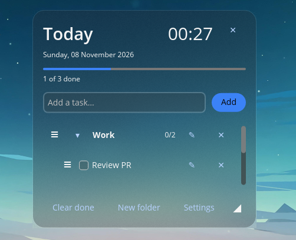
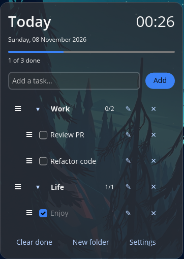
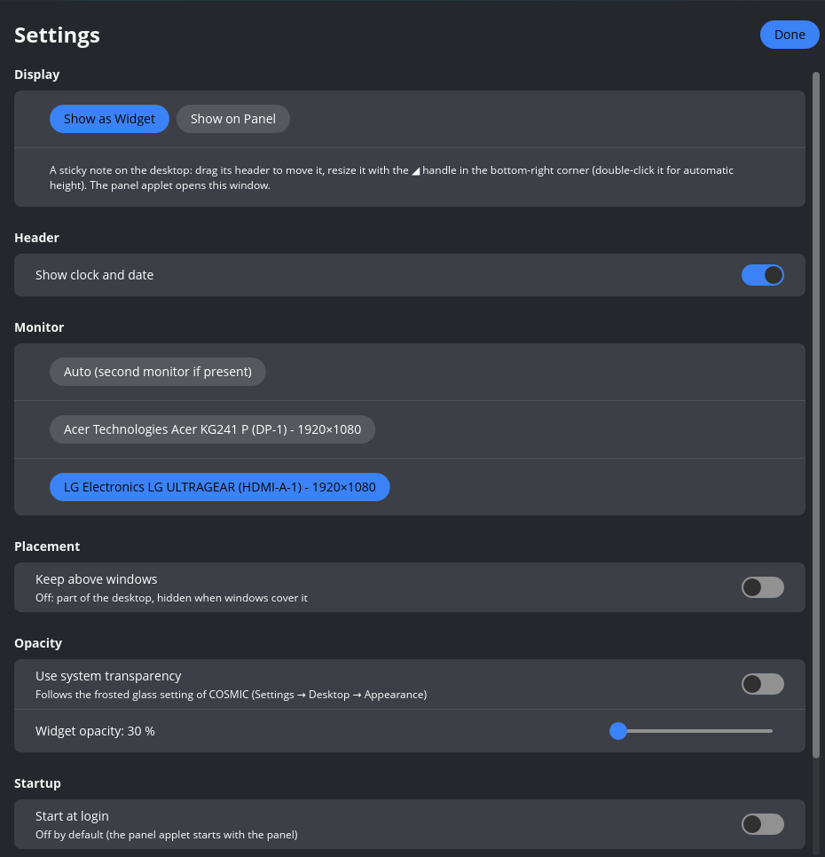

# COSMIC Todo Widget

[](https://github.com/Diogo1457/cosmic-todo-widget/actions/workflows/ci.yml)
[](https://github.com/Diogo1457/cosmic-todo-widget/releases/latest)
[](LICENSE)

A simple daily to-do list for the [COSMIC](https://system76.com/cosmic) desktop (Pop!_OS 24.04). Keep it on your desktop like a sticky note, or tuck it into the panel and open it with one click.

<p align="center">
  
  &nbsp;&nbsp;
  
</p>

## What it does

- **Add, tick off, rename and delete tasks.** Finished tasks sink to the bottom and a progress bar shows how far along you are.
- **Folders** to group tasks. Click a folder and new tasks go straight into it.
- **Drag and drop** with the ≡ handle to reorder tasks or move them into a folder.
- **Right-click** a task, a folder or the empty space for quick *New task* / *New folder*.
- **Two ways to show it:** a free-floating widget on your desktop, or a popup from the COSMIC panel.
- **Looks like COSMIC:** it follows your theme and, as a widget, your frosted-glass transparency setting.
- **Remembers everything:** your tasks, settings, and where you left the widget.

## Install

Pick one of these. Everything is installed just for your user, no `sudo` needed.

### Option 1: Binary (widget and panel)

This is the full version. Download `cosmic-todo-widget-…-x86_64-linux.tar.gz` from the [latest release](https://github.com/Diogo1457/cosmic-todo-widget/releases/latest), then:

```bash
tar -xzf cosmic-todo-widget-*-x86_64-linux.tar.gz
cd cosmic-todo-widget-*-x86_64-linux
./install.sh
```

To remove it later, run `./install.sh uninstall` (your tasks are kept).

### Option 2: Flatpak (panel only)

Download `todo-widget.flatpak` from the [latest release](https://github.com/Diogo1457/cosmic-todo-widget/releases/latest), then:

```bash
flatpak remote-add --user --if-not-exists flathub https://dl.flathub.org/repo/flathub.flatpakrepo
flatpak install --user todo-widget.flatpak
```

The desktop widget cannot run inside Flatpak (COSMIC does not allow sandboxed apps to draw on the desktop), so the Flatpak only offers the panel version. Want the widget? Use the binary.

### Option 3: Build it yourself

You need Pop!_OS 24.04 (or Ubuntu 24.04) and `git`. The script takes care of the rest: build tools, Rust and the app.

```bash
sudo apt install git just
git clone https://github.com/Diogo1457/cosmic-todo-widget.git
cd cosmic-todo-widget
just install
```

The first build takes a few minutes. Later, `just update` rebuilds and reinstalls after you change something. Run `just` to see everything it can do.

## Show it in the panel

After installing, add the applet once:

1. Open **COSMIC Settings → Desktop → Panel** (or **Dock**).
2. Choose **Configure panel applets**.
3. Add **Todo Widget**.

If it is not in the list, log out and back in. Click its icon in the panel to open your list.

## Settings

Open them from the **Settings** button in the list.

<p align="center">
  
</p>

- **Display:** *Show on Panel* (the default) or *Show as Widget* on the desktop. While it is set to *Widget*, clicking the panel icon opens these settings.
- **Widget only:** which monitor to use, whether it stays above your windows or behind them, and its opacity. It follows your system transparency unless you turn that off.
- **Move and resize** the widget by dragging its header and the ◢ corner. Double-click the corner for automatic height.
- **Start at login:** off by default.
- **Restore defaults:** resets the settings, position and size. Your tasks are never touched.

## Your data

Everything is stored as plain text files, so it is easy to back up:

| What | Where |
|---|---|
| Settings | `~/.config/todo-widget/settings.json` |
| Tasks and widget position | `~/.local/share/todo-widget/tasks.json` |

Uninstalling keeps these files. In the Flatpak they live in `~/.var/app/io.github.Diogo1457.CosmicTodoWidget/`.

## For developers

The app is written in Rust with [libcosmic](https://github.com/pop-os/libcosmic).

```bash
just check     # formatting, lints and tests (the same checks as GitHub)
just test      # only the tests
just fmt       # format the code
just dist      # build the release tarball
```

Every change is checked by GitHub Actions. The code is in `src/`; the desktop entries, icon and installer are in `resources/`; the Flatpak recipe is in `flatpak/`.

**Making a release:** `just bump 0.2.0`, commit, then `just release`. That tags the version, and GitHub builds the tarball and the Flatpak and publishes them on the [releases page](https://github.com/Diogo1457/cosmic-todo-widget/releases).

## License

GPL-3.0-only
